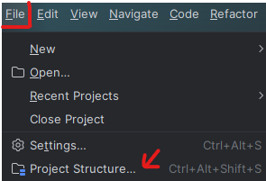
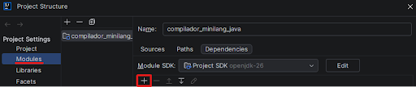
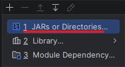
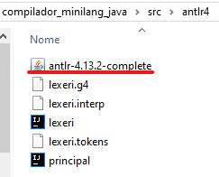
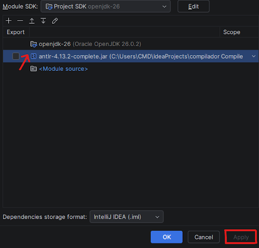

# Compilador MiniLang (Java)

Implementação de um interpretador para a **MiniLang**, uma linguagem de programação
imperativa e extremamente simplificada, criada para fins didáticos na disciplina de
Compiladores / Linguagens Formais e Autômatos.
- O código foi feito utilizando-se da _**IDE IntelliJ**_<br>

A especificação completa da linguagem (gramática BNF, tokens, léxica, sintática, semântica operacional e exemplos) 

> ⚠️ **Status do projeto: finalizado.**

## Sobre a MiniLang

- Paradigma imperativo e procedural
- Único tipo de dado: inteiros não negativos
- Escopo global (até 26 variáveis, `a`–`z`, `a`–`z`[0-9])
- Comandos de entrada/saída (`read`, `write`)
- Estruturas de controle: sequência, `if`/`else` e `while`

## Arquitetura planejada

```
Código-fonte (.minilang)
        │
        ▼
  Analisador Léxico  (lexico.java + leitor.java)  →  fluxo de Tokens
        │
        ▼
  Analisador Sintático (parser)                    →  AST
        │
        ▼
  Interpretador (avaliador da semântica operacional) → Saída
```

### Estrutura do repositório

```
src/
├── Cabeca.java        # Função principal que recebe entradas, faz chamados de funções e imprimi saídas
├── Cabeca.class       # Arquivo class gerado na "compilação" da classe Cabeca
├── compilar.bat        # Arquivo .bat para executar o código juntando a parte java com a parte antlr4
├── compilar.sh       # Arquivo .sh para automatizar a tarefa de compilar o código
├── ErroCompilacao.java  # Demonstração de erros de compilação com base na léxica e sintática da gramática
├── ErroCompilacao.class # Arquivo class gerado na "compilação" da classe ErroCompilacao
├── Interpretador.java    # Arquivo java que interpreta os comandos e condições
├── leitor.java        # Leitor de arquivo com buffer duplo e rollback de lexema
├── leitor.class        # Arquivo class gerado na "compilação" da classe leitor
├── lexic.java          # Programa de teste do lexer (imprime os tokens de um arquivo)
├── lexic.class        # Arquivo class gerado na "compilação" da classe lexic
├── lexico.java        # Analisador léxico (reconhecimento de tokens)
├── lexico.class        # Arquivo class gerado na "compilação" da classe lexico
├── Main.java        
├── Main.class        # Arquivo class gerado na "compilação" da classe main
├── No.java          # Representação de nós para a criação de uma AST
├── No.class        # Arquivo class gerado na "compilação" da classe no
├── Parser.java         # Analisador sintático (reconhecimento da "escrita" da oração da gramática)
├── Parser.class        # Arquivo class gerado na "compilação" da classe parser
├── TipoToken.java    # Enum com os tipos de token da linguagem
├── TipoToken.class   # Arquivo class gerado na "compilação" da classe TipoToken
├── Token.java        # Representação de um token (tipo + lexema)
└── Token.class         # Arquivo class gerado na "compilação" da classe Cabeca
└── antlr/├──antlr-4.13.2-complete.jar # Versão do Antlr4 para usar como Token
          ├──gramatica.txt # Gramática minilang em txt
          ├──Aritimetico.java # Classe java responsável por cálculos aritiméticos
          ├──expr.g4 # Código Antlr4 responsável pela precedência das operações e lógica aritimética
          ├──expr.interp # Interpretador gerado pelo expr.g4
          ├──expr.tokens # Tokens gerados pelo expr.g4
          ├──exprBaseListener.java # Lista gerado pelo expr.g4
          ├──exprBaseVisitor.java # Visitor gerado pelo expr.g4
          ├──exprLexer.java # Lexer gerado pelo expr.g4
          ├──exprLexer.interp # Interpretador léxico gerado pelo expr.g4
          ├──exprLexer.tokens # Tokens léxicos gerado pelo expr.g4
          ├──exprListener.java # Lista gerado pelo expr.g4
          ├──exprParser.java # Código Antlr4 responsável pela precedência das operações e lógica aritimética
          ├──exprVisitor.java # Visitor gerado pelo expr.g4
          ├──lexeri.java # Classe java gerada pelo lexeri.g4
          ├──lexeri.g4   # Léxica da gramática feita apartir do Antlr4
          ├──lexeri.interp # Interpretador gerado pelo lexeri.g4
          ├──lexeri.token # Tokens gerados pelo lexri.g4
          └──principal.java
exemplos/
├──calc.minilang        # Exemplo de um calculo matemático sem a estrutura de código minilang
├──maximo.minilang        # Exemplo funcional de código minilang em cálculo aritimético
├──erro.minilang         # Exemplo de erros na linguagem minilang 
├──fatorial.minilang      # Exemplo funcional de código minilang em fatorial
├──maximo.minilang        # Exemplo funcional de código minilang em valor máximo
└──soma_ate_zero.minilang   # Exemplo funcional de código minilang em soma até zero
```

## Como compilar e rodar

### Antlr4

- Primeiro deve-se abir o Terminal da IDE, no exemplo usado o Intelij, onde pode ser aberto pelo ícone ou pelo atalho Alt+F12 e colocar o caminho de onde está os arquivos .g4

```bash
cd compilador_minilang_java\src\antlr4
```

- Depois deve se gerar os arquivos da gramática caso eles não existam dentro da pasta antlr4 através da linha de comando:<br>
  
(⚠️ ***Atualmente no código não se faz necessário para compilar, somente caso queira alterar o código***)

```bash
java -jar antlr-4.13.2-complete.jar lexeri.g4
java -jar antlr-4.13.2-complete.jar expr.g4
```

- Por Fim deve-se setar as dependências para poder usar o antrl4







- E escolha a pasta no seu diretório antlr4 onde estiver o diretório do código instalado, o arquivo antl-4.13.2-complete.jar



- Para aplicar as dependências, basta selecionar o .exe ainda no no menu de módulos e aplicá-lo



Após as dependências, basta executar o comando a seguir no cmd da IDE, para rodar o código
```bash
Ex: src\compilar.bat exemplos\calculo.minilang
```
### Jdk

Para a compilação do código é necessário uma versão atualizada do Kit de Desenvolvimento Java a partir da versão 26

Também se faz necessário a utilização de uma versão Java a partir da versão 11

## Roadmap / o que falta

- [ ] Interpretador seguindo a semântica operacional da seção 4 da especificação:
  - [ ] Tabela de símbolos (26 variáveis, inicializadas em 0)
  - [ ] Avaliador de expressões aritméticas (`aval`)
  - [ ] Avaliador de expressões relacionais (`avr`)
  - [ ] Execução de comandos (atribuição, sequência, condicional, laço)
  - [ ] Fila de entrada / lista de saída
  - [ ] Erro de execução para divisão por zero

## Tokens reconhecidos

| Token | Padrão | Exemplo |
|---|---|---|
| `PROGRAM` | `program` | `program` |
| `BEGIN` | `begin` | `begin` |
| `END` | `end` | `end` |
| `READ` | `read` | `read` |
| `WRITE` | `write` | `write` |
| `IF` / `THEN` / `ELSE` | `if` / `then` / `else` | — |
| `WHILE` / `DO` | `while` / `do` | — |
| `ID` | `[a-z][a-z0-9]*` | `x`, `contador` |
| `NUMBER` | `[0-9]+` | `0`, `42` |
| `ASSIGN`, `PLUS`, `MINUS`, `TIMES`, `DIVIDE` | `=`, `+`, `-`, `*`, `/` | — |
| `EQ`, `LT`, `GT`, LE, GE | `==`, `<`, `>` , `=<`, `>=` | — |
| `LPAREN`, `RPAREN`, `LBRACE`, `RBRACE` | `(`, `)`, `{`, `}` | — |
| `SEMICOLON`, `COLON`, `COMMA`, `DOT` | `;`, `:`, `,`, `.` | — |
| `COMMENT` | `//[^\n]*` | `// comentário` |
| `CADEIA` | `" "` | 'hello world" |
| `EOF` | "$" | "EOF/$"

## Autores

_Daniel Santiago Purificação_<br>
_Felipe de Lima Monteiro_<br>
_João Vitor Ludovino Leite Alves_<br>
_Nicolas Caldeira dos Santos_<br>
_Nicolas Jimenes Haase_<br>
_Pedro Dias Guedes Santos_<br>

## Disciplina

Compiladores: trabalho prático de implementação de um interpretador para uma
linguagem educacional, com foco em Linguagens Formais, Autômatos e Computabilidade.
